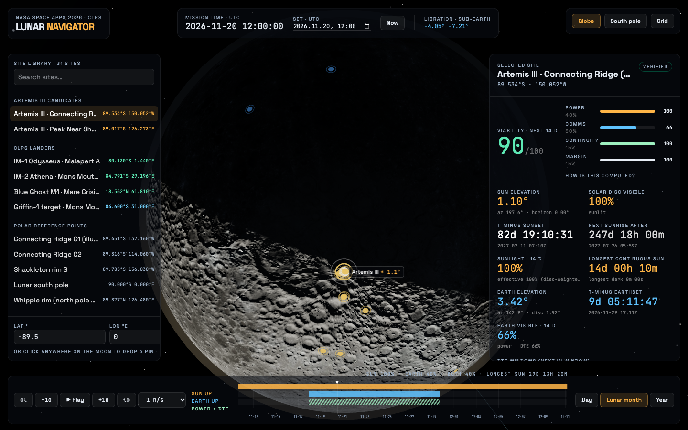
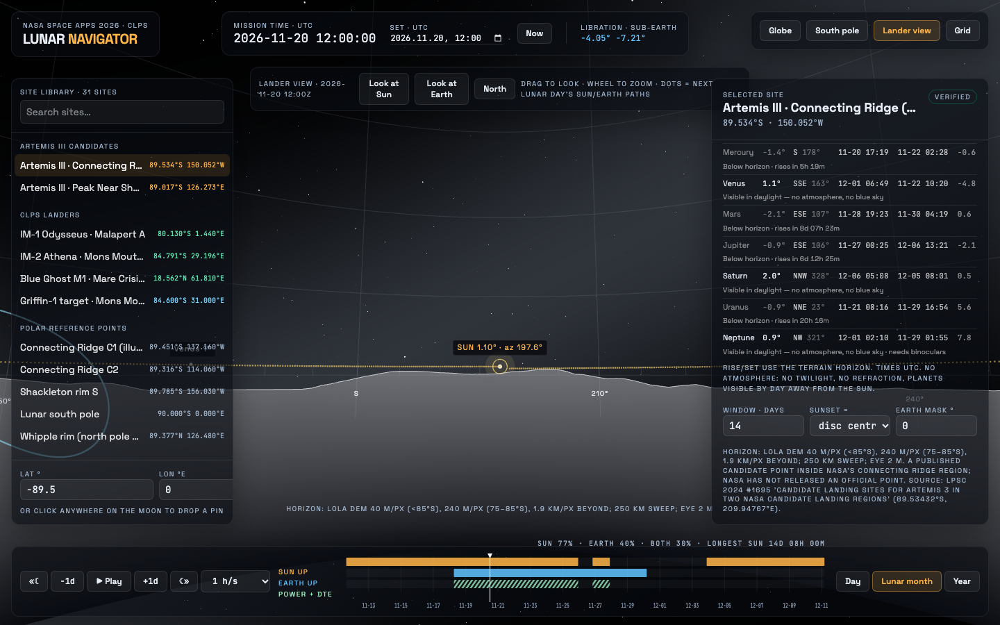
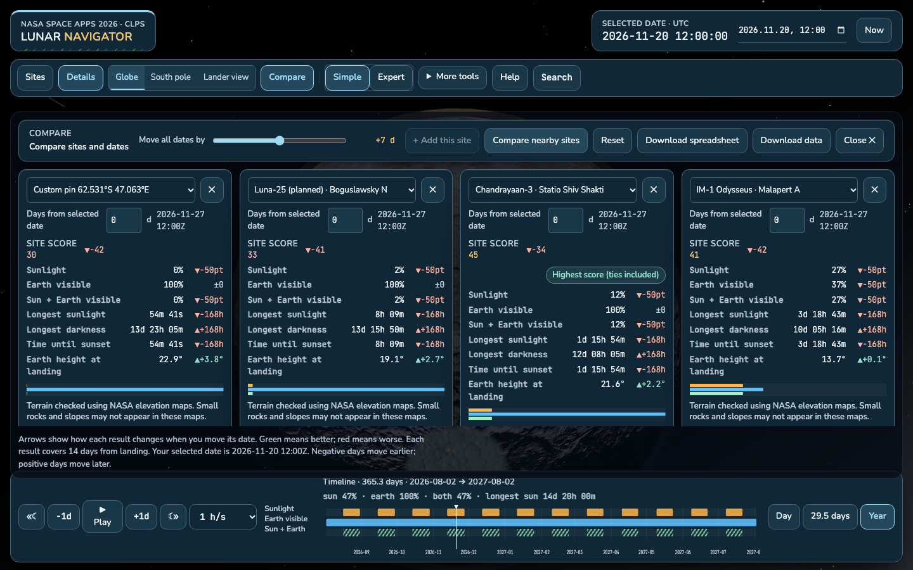

# Lunar Navigator

**NASA Space Apps Challenge 2026 · "Lunar Landing Site Navigator" (CLPS)**

Pick a landing site and a date. In under ten seconds, see whether it has sunlight and a line of sight to Earth, what the lander would actually see on the horizon, and what a launch slip costs.



| Lander's-eye view with real LOLA terrain | Compare scenarios with a launch-slip slider |
|---|---|
|  |  |

## Run it

```bash
npm install
npm run dev        # http://localhost:5173
npm run build      # static site in dist/ (deploy to Vercel, GitHub Pages: BASE_PATH=/repo/ npm run build)
npm test           # Vitest: ephemeris vs JPL Horizons, events, terrain sweep
npm run typecheck
npx playwright test  # screenshots in docs/screens
```

Data pipeline (already run; outputs are committed in `public/data` and `public/textures`):

```bash
npx tsx scripts/fetch-horizons.ts   # JPL Horizons fixtures (needs network)
npm run data:ephem                  # hourly body-fixed Sun/Earth table 2023–2031
npm run data:textures               # Moon colour + LOLA relief normal map (needs .cache/ sources)
npm run data:horizons               # terrain horizon profiles for the 31 library sites
npm run data:tiles                  # downsampled DEM tiles for custom pins
npm run validate && npm run validate:horizon   # regenerates VALIDATION.md
```

## What it does

- **3D Moon globe** with LROC colour, LOLA-derived relief shading, a soft terminator, earthshine, a 15° selenographic grid, glowing pins with day/night rings, smooth fly-to, south-pole view, click-to-drop pins.
- **31-site library** with sources and confidence flags: Apollo, CLPS (IM-1, IM-2, Blue Ghost M1, Griffin-1 target), Artemis III candidate points, Chandrayaan-3, Chang'e-3/4/5/6, SLIM, Luna-25 (planned), robotic pioneers, and Gläser et al. polar illumination optima.
- **Dashboard**: Sun/Earth elevation, visible solar-disc fraction, live T-minus to sunset and Earthset, sunlight % and longest continuous sunlight over a window, Earth windows, a transparent 0–100 viability score, and a timeanddate-style **"Sky from the site"** table (rise, set, direction, visibility comment) for the Sun, Earth and planets.
- **Timeline**: Sun-up, Earth-up and both-up bands over a day, a lunar month or a year; hover, click-to-jump, drag-to-scrub, playback at six speeds, ±1 day / ±1 lunar day.
- **Lander view**: 360° sky dome with the LOLA terrain silhouette, the Sun at 0.53° and the Earth at 1.9° with phase, planets, compass and elevation grid, and the next lunar day's Sun and Earth tracks (the Earth's libration loop is visible).
- **Compare**: 2–4 scenarios (site × date), a launch-slip slider with signed green/red deltas, "same date, nearby sites", CSV/JSON export.
- **Planner / Explorer** modes, guided tour, boot intro with an Earth-side fly-in, command palette (Ctrl/⌘ K), keyboard shortcuts, event toasts, Methodology panel, shareable URL state, reduced-motion support, WebGL fallback.

## How it works

```
astronomy-engine (Sun, Moon vectors; IAU/WGCCRE 2009 Moon rotation incl. physical libration)
        │  body-fixed Sun/Earth vectors, hourly table 2023–2031 (1.1 MB) + exact path
        ▼
site frame (east/north/up on the 1737.4 km sphere, Earth parallax)  ──►  az/el series
        │                                                                     │
LOLA DEM (40 m / 240 m / 1.9 km)  ──►  360° horizon profile per site  ──►  visibility, windows,
                                       (great-circle sweep, 250 km, eye 2 m)   events (bisection), score
```

Site-independent geometry is computed once per time step; a site only adds three dot products and a horizon lookup, so a year-long timeline for four scenarios is sub-millisecond and the slip slider is instant.

Source layout: `src/astro` (pure TypeScript engine, no DOM), `src/scenes` (react-three-fiber globe and dome, GLSL in `shaders/`), `src/ui` (panels), `src/state` (Zustand + URL), `src/workers` (custom-pin horizons), `scripts` (data pipeline), `tests` (Vitest), `e2e` (Playwright).

## Accuracy

- Sun and Earth az/el vs **JPL Horizons** (Moon-surface observer, 1 208 epochs, 4 sites incl. 89.9°S): max 0.009° / 0.004°. See [VALIDATION.md](VALIDATION.md).
- Terrain illumination at the Gläser et al. (2018) south-pole reference points reproduced within 1–9 percentage points; the north-pole gap is explained there (crest resolution).
- No refraction, no twilight: the Moon has no atmosphere. Everything else that is not modelled is listed in the in-app Methodology panel and in [LIMITATIONS.md](LIMITATIONS.md).

## Credits and data

NASA/GSFC/Arizona State University LRO **LOLA** GDR (PDS Geosciences Node) · NASA **SVS** CGI Moon Kit (LROC WAC colour) · NASA **Blue Marble** · NASA/JPL **Horizons** · LROC / Wagner et al. 2017 (Apollo coordinates) · ISRO, CNSA, JAXA, Intuitive Machines, Firefly Aerospace, NASA LRO (recent landings) · LPSC 2024 #1695 (Artemis III candidate points) · Gläser et al. 2018 (polar illumination) · [astronomy-engine](https://github.com/cosinekitty/astronomy) (MIT) · three.js, react-three-fiber, drei, D3, Zustand, Tailwind, Vite.

Built for NASA Space Apps 2026. Not affiliated with NASA.

# NASA
