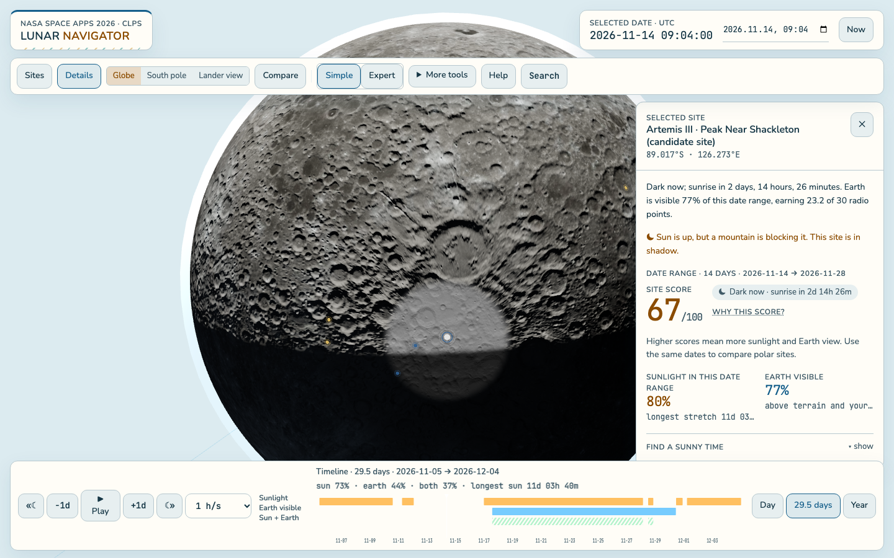
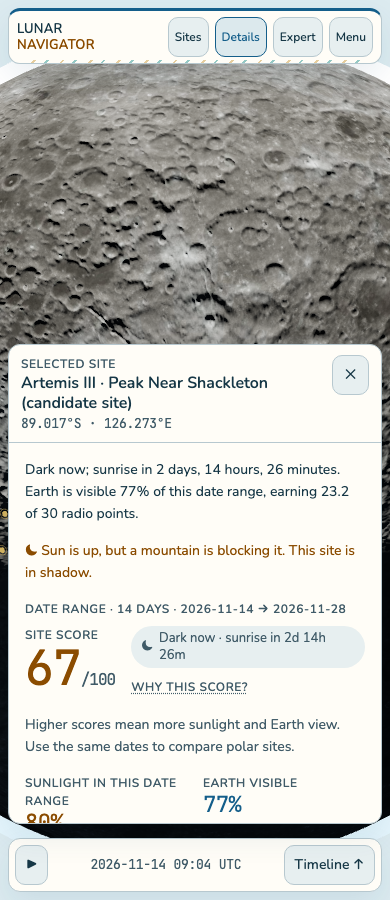
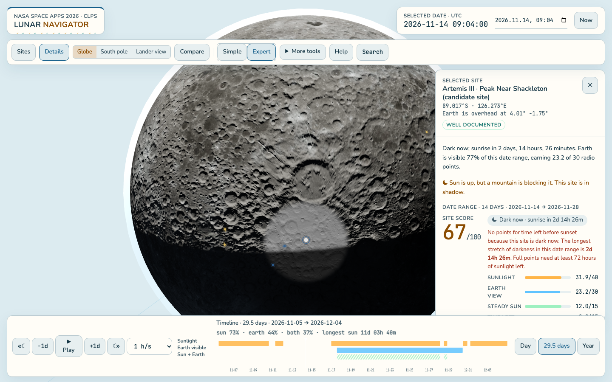

# Lunar Navigator

**NASA Space Apps Challenge 2026 · CLPS** · **Live: <https://steppex.vercel.app>**

Lunar Navigator turns a landing site and a date into a straight answer: how much sunlight that spot really gets once the surrounding mountains are taken into account, and when Earth is above the horizon for a direct radio link. Every number comes from NASA LOLA elevation maps and positions checked against JPL Horizons to 0.009°, so a mission planner, a judge or a curious visitor can all see where the answer comes from.

The project is named **Lunar Navigator** throughout the app and documentation; `lunar-navigator` is its npm package identifier.

Pick a landing site and a date. In under ten seconds, see whether it has sunlight and a line of sight to Earth, what the lander would actually see on the horizon, and what a launch slip costs.



| Simple · everyday exploration | Expert · advanced planning |
|---|---|
|  |  |

## Run it

```bash
npm install
npm run dev        # http://localhost:5173
npm run build      # static site in dist/ (deploy to Vercel, GitHub Pages: BASE_PATH=/repo/ npm run build)
npm test           # Vitest: ephemeris vs JPL Horizons, events, terrain sweep
npm run typecheck
npx playwright install chromium  # first-time browser setup
npx playwright test  # uses the production build above; screenshots in docs/screens
```

Data pipeline (already run; outputs are committed in `public/data` and `public/textures`):

```bash
node --import tsx scripts/build-polar-hillshade.ts  # polar maps from cached LOLA DEMs
npx tsx scripts/fetch-horizons.ts   # JPL Horizons fixtures (needs network)
npm run data:ephem                  # hourly body-fixed Sun/Earth table 2023–2031
npm run data:textures               # Moon colour + LOLA relief normal map (needs .cache/ sources)
npm run data:horizons               # terrain horizon profiles for the 31 library sites
npm run data:tiles                  # downsampled DEM tiles for custom pins
npm run data                        # runs all four data build tasks above; needs cached sources
node --import tsx scripts/build-polar-illumination.ts              # south-pole sunlight grid (~9 min)
node --import tsx scripts/build-polar-illumination.ts --peaks-only # re-rank the peaks from the grid on disk
npm run validate && npm run validate:horizon   # regenerates VALIDATION.md
```

## What it does

- **3D Moon globe** with LROC colour, LOLA-derived relief shading, a soft terminator, earthshine, a 15° selenographic grid, glowing pins with day/night rings, smooth fly-to, south-pole view, click-to-drop pins.
- **31-site library** with sources and confidence flags: Apollo, CLPS (IM-1, IM-2, Blue Ghost M1, Griffin-1 target), Artemis III candidate points, Chandrayaan-3, Chang'e-3/4/5/6, SLIM, Luna-25 (planned), robotic pioneers, and Gläser et al. polar illumination optima.
- **Dashboard**: refined sunrise/sunset and Earth-visibility spans clipped to the exact mission start and end; default radio clearance of 5° above terrain (0° remains available). Includes a full-night estimate beyond the mission end and a user-entered battery-hours check. Also shows Sun/Earth elevation, visible solar-disc fraction, live T-minus to sunset and Earthset, sunlight % and longest continuous sunlight over a window, Earth windows, a transparent 0–100 viability score, and a timeanddate-style **"Sky from the site"** table (rise, set, direction, visibility comment) for the Sun, Earth and planets.
- **Polar terrain map**: real polar-stereographic LOLA hillshade with a latitude graticule, zoomable, with fixed-size collision-filtered pins. Fixed display lighting is labeled separately from predicted sunlight.
- **South-pole sunlight map**: share of a year or a calendar month in sunlight, on a 1.19 km grid of 51 468 terrain horizon sweeps, with a **peaks-of-eternal-light** list. Each listed peak is searched locally at the full 1° sweep, so the best point lands on the Connecting Ridge at 87 % of 2026 in sunlight, against the 88 % Gläser et al. publish for that ridge at 2 m eye height. Opening one drops a pin carrying that exact horizon profile.
- **Timeline**: Sun-up, Earth-up and both-up bands over a day, a lunar month or a year; hover, click-to-jump, drag-to-scrub, playback at six speeds, ±1 day / ±1 lunar day.
- **Lander view**: 360° sky dome with the LOLA terrain silhouette, the Sun at 0.53° and the Earth at 1.9° with phase, planets, compass and elevation grid, and the next lunar day's Sun and Earth tracks (the Earth's libration loop is visible).
- **Compare**: 2–4 scenarios (site × date), a launch-slip slider with signed green/red deltas, "same date, nearby sites", CSV/JSON export.
- **Simple / Expert** experiences share the same site and date. Simple shows the essentials; Expert adds full measurements, visibility settings, battery checks, daily landing-date comparison and a monthly site-by-date score map over a year. Includes a light Mongolian-inspired theme, saved dark mode, touch/keyboard glossary, dismissible panels, guided tour, boot intro with an Earth-side fly-in, command palette (Ctrl/⌘ K), keyboard shortcuts, event toasts, Methodology panel, shareable URL state, reduced-motion support, WebGL fallback.

## How it works

```
astronomy-engine (Sun, Moon vectors; IAU/WGCCRE 2009 Moon rotation incl. physical libration)
        │  body-fixed Sun/Earth vectors, hourly table 2023–2031 (1.1 MB) + exact path
        ▼
site frame (east/north/up on the 1737.4 km sphere, Earth parallax)  ──►  az/el series
        │                                                                     │
LOLA DEM (40 m / 240 m / 1.9 km)  ──►  360° horizon profile per site  ──►  visibility, windows,
                                       (great-circle sweep, 250 km, eye 2 m)   events (bisection), score
```

Site-independent geometry is computed once per time step; a site only adds three dot products and a horizon lookup, so a year-long timeline for four scenarios is sub-millisecond and the slip slider is instant.

Source layout: `src/astro` (pure TypeScript engine, no DOM), `src/scenes` (react-three-fiber globe and dome, GLSL in `shaders/`), `src/ui` (panels), `src/state` (Zustand + URL), `src/workers` (custom-pin horizons), `scripts` (data pipeline), `tests` (Vitest), `e2e` (Playwright).

## Validation

Two independent checks, both reproducible from this repository.

**Positions against NASA JPL Horizons.** Topocentric azimuth and elevation of the Sun and Earth
from a lunar surface observer, across 1 208 epochs at four sites including 89.9°S:

| Body | Max separation | Mean | Tolerance |
|---|---|---|---|
| Sun | 0.0090° | 0.0050° | 0.1° |
| Earth | 0.0036° | 0.0016° | 0.1° |

```bash
npm test                            # tests/horizons.test.ts enforces this offline against committed fixtures
npx tsx scripts/fetch-horizons.ts   # refetch the Horizons fixtures (needs network)
npm run validate                    # rewrite the Horizons section of VALIDATION.md
```

**Terrain illumination against Gläser et al. (2018).** Our hourly 2024–2025 sweep with a LOLA-derived
horizon at 2 m eye height, against their 20-year study at 20 m/px. The three south-pole sites agree
within 1 to 9 percentage points:

| Site | Average illumination, ours | published | Difference |
|---|---|---|---|
| Shackleton rim S | 83.4 % | 81 % | +2.4 |
| Connecting Ridge C1 | 76.8 % | 76 % | +0.8 |
| Connecting Ridge C2 | 66.2 % | 75.6 % | −9.4 |

```bash
npm run validate:horizon               # rewrite the Gläser comparison in VALIDATION.md
node --import tsx scripts/dev/check-whipple.ts   # the 720 m pixel-sensitivity probe
```

The fourth site in the published table, Whipple rim at the north pole, differs by far more. That is a
resolution effect, not a disagreement: our 240 m/px north tile misses the rim crest, and the best
pixel within 720 m of the published point gives 77.0 % against our 43.9 % at the point itself. It is
the clearest evidence for the caveat that a horizon profile describes one pixel. Full tables,
method and residual analysis are in [VALIDATION.md](VALIDATION.md).

- No refraction and no twilight: the Moon has no atmosphere. Everything else that is not modelled is
  listed in the in-app Methodology panel and in [LIMITATIONS.md](LIMITATIONS.md).

## Credits and data

NASA/GSFC/Arizona State University LRO **LOLA** GDR (PDS Geosciences Node) · NASA **SVS** CGI Moon Kit (LROC WAC colour) · NASA **Blue Marble** · NASA/JPL **Horizons** · LROC / Wagner et al. 2017 (Apollo coordinates) · ISRO, CNSA, JAXA, Intuitive Machines, Firefly Aerospace, NASA LRO (recent landings) · LPSC 2024 #1695 (Artemis III candidate points) · Gläser et al. 2018 (polar illumination) · [astronomy-engine](https://github.com/cosinekitty/astronomy) (MIT) · three.js, react-three-fiber, drei, D3, Zustand, Tailwind, Vite.

Built for NASA Space Apps 2026. Not affiliated with NASA.
